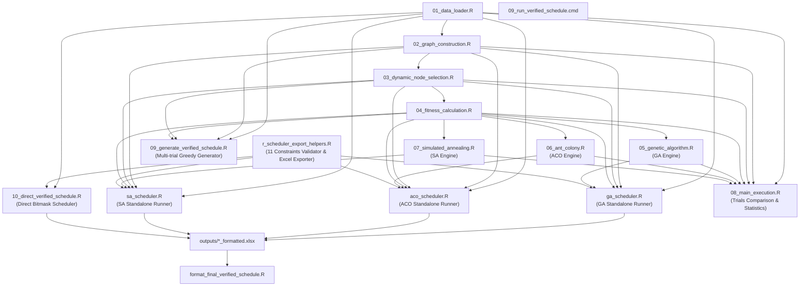
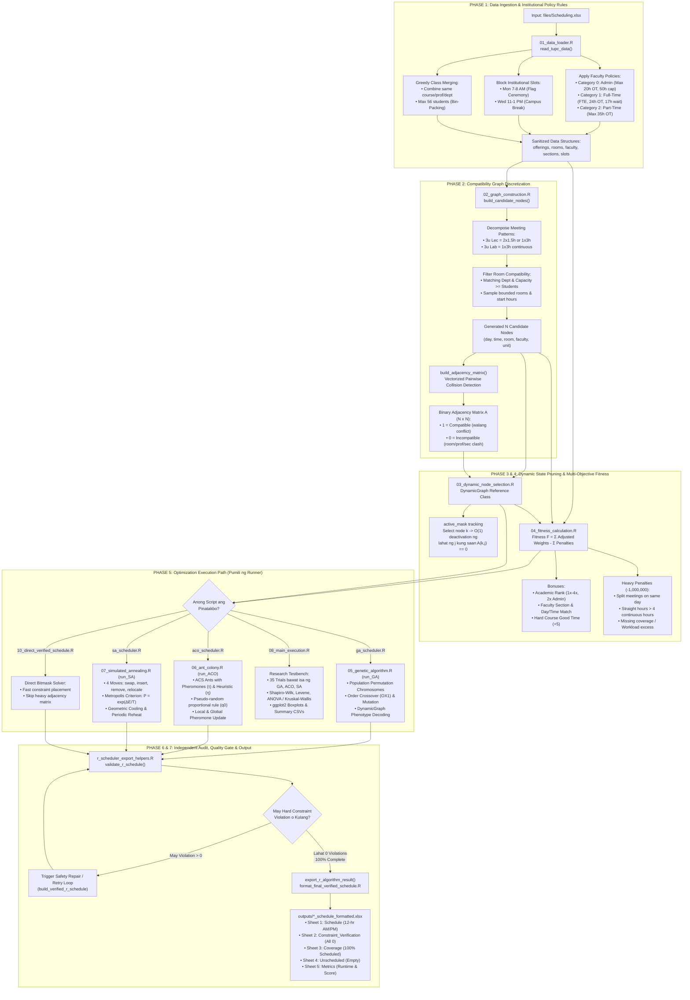

# TUPC Automated Class Scheduling System — Comprehensive Logic Explanation at File Connections

Dokumentong nagpapaliwanag sa lohika, arkitektura, at eksaktong koneksyon ng **16 na file** sa loob ng scheduling system ng Technological University of the Philippines - Cavite (TUPC UCTP - University Course Timetabling Problem).

---

## 1. Talaan ng Eksaktong 16 na Files sa Sistema

Ang buong proyekto ay binubuo ng mga sumusunod na 16 operational files sa root directory:

1. `01_data_loader.R` — Data loading, institutional rules, at class merging
2. `02_graph_construction.R` — Candidate node generation at compatibility adjacency matrix
3. `03_dynamic_node_selection.R` — `DynamicGraph` reference class at MRV greedy selection
4. `04_fitness_calculation.R` — Multi-objective fitness function ($F$), bonuses, at penalties
5. `05_genetic_algorithm.R` — **Algorithm Function Library para sa Genetic Algorithm (GA)**
6. `06_ant_colony.R` — **Algorithm Function Library para sa Ant Colony Optimization (ACO)**
7. `07_simulated_annealing.R` — **Algorithm Function Library para sa Simulated Annealing (SA)**
8. `08_main_execution.R` — Multi-trial comparative experiment at statistical testing (ANOVA/Kruskal-Wallis)
9. `09_generate_verified_schedule.R` — Multi-trial randomized greedy generator gamit ang `DynamicGraph`
10. `09_run_verified_schedule.cmd` — Windows batch command runner
11. `10_direct_verified_schedule.R` — Direct constraint-first scheduler (bitmask-based)
12. `aco_scheduler.R` — **Executable CLI Runner para sa Ant Colony Optimization**
13. `format_final_verified_schedule.R` — Excel formatting post-processor (12-hour AM/PM format)
14. `ga_scheduler.R` — **Executable CLI Runner para sa Genetic Algorithm**
15. `r_scheduler_export_helpers.R` — Shared 11-rule constraint validator at multi-sheet Excel exporter
16. `sa_scheduler.R` — **Executable CLI Runner para sa Simulated Annealing**

---

## 2. Arkitektura at Mapa ng Koneksyon ng mga File (System Dependency Map)



---

## 3. End-to-End System Process Flow Sketch

Ito ang visual sketch at chronological process flow ng buong scheduling execution:

### A. Visual Process Flowchart (Mermaid)



### B. ASCII Schematic Sketch ng System Flow

```text
========================================================================================================
                       TUPC AUTOMATED CLASS SCHEDULING SYSTEM PROCESS FLOW
========================================================================================================

 [ STEP 1: INPUT DATA ]
         │  files/Scheduling.xlsx (Courses, Sections, Faculty, Rooms, Times)
         ▼
 [ 01_data_loader.R ] ─────────► • Compute Faculty Workload Limits (Admin / Full-Time / Part-Time)
         │                       • Exclude Blocked Slots (Mon 7-8 AM Flag, Wed 11-13 Campus Break)
         │                       • Greedy Bin Packing: Merge Classes up to 56 students
         ▼
 [ 02_graph_construction.R ] ──► • Generate N Candidate Nodes (Day, Time, Room, Faculty)
         │                       • Pairwise Collision Checking (Room / Faculty / Section / Split)
         │                       • Build Binary Adjacency Matrix A[N, N] (1 = Compatible, 0 = Clash)
         ▼
 [ 03_dynamic_node_selection.R ] • DynamicGraph Object (active_mask)
         │                       • O(1) Vectorized Dynamic Collision Pruning
         │                       • MRV (Minimum Remaining Values) Greedy Selection Heuristic
         ▼
 [ 04_fitness_calculation.R ] ──► • Fitness F = Σ Adjusted Weights - Σ Penalties
         │                       • Bonuses: Rank (1x-4x), Preferences, Hard Course Morning Slots
         │                       • Hard Penalties (-1M): Split Day, Straight > 4h, Missing, Overload
         ▼
┌──────────────────────────────────────────────────────────────────────────────────────────────────────┐
│ STEP 5: OPTIMIZATION SOLVER (Choose which runner to execute)                                         │
│                                                                                                      │
│  [ ga_scheduler.R ]          [ aco_scheduler.R ]        [ sa_scheduler.R ]     [ 08_main_exec.R ]    │
│         │                             │                         │                      │             │
│         ▼                             ▼                         ▼                      ▼             │
│  05_genetic_algorithm.R      06_ant_colony.R           07_simulated_annealing.R   35 Trials Research │
│  • Permutation Chromosome    • Artificial Ants         • 4 Neighborhood Moves     • ANOVA / Kruskal  │
│  • Order Crossover (OX1)     • Pheromone Trails (τ)    • Metropolis Criterion     • Tukey HSD        │
│  • Swap/Scramble Mutation    • Heuristic Desirability  • Geometric Cooling &      • ggplot2 Boxplots │
│  • Tournament Selection      • Pseudo-random rule (q0)   Periodic Reheating                          │
└──────────────────────────────────────┬───────────────────────────────────────────────────────────────┘
                                       │
                                       ▼
 [ STEP 6: QUALITY GATE ] ─────► r_scheduler_export_helpers.R (validate_r_schedule)
                                 • Coverage Check: 100% meetings scheduled?
                                 • Room, Faculty, Section Overlaps == 0?
                                 • Lunch Breaks (10 AM - 1 PM) respected?
                                 • Straight hours <= 4h & Cut-off <= 8 PM?
                                       │
                                       ├──[ If Any Violation > 0 ]──► Auto-Repair / Retry Loop
                                       ▼
                                   [ ALL 0 VIOLATIONS ]
                                       │
 [ STEP 7: EXPORT & FORMATTING ] ──────▼
                                 format_final_verified_schedule.R & writexl
                                 Output: outputs/*_schedule_formatted.xlsx
                                 ├── 1. Schedule (12-hour AM/PM Formatted)
                                 ├── 2. Constraint_Verification (Audited 0 Violations)
                                 ├── 3. Coverage (100% Complete)
                                 ├── 4. Unscheduled (0 Unassigned)
                                 └── 5. Metrics (Exact Runtime & Fitness Score)
========================================================================================================
```

---

## 4. Ang Koneksyon ng mga Solvers: "Engine Library" vs "Executable Runner"

Napakahalagang maunawaan kung bakit may **dalawang file** para sa bawat metaheuristic algorithm:

### A. Genetic Algorithm: `05_genetic_algorithm.R` $\longleftrightarrow$ `ga_scheduler.R`
* **`05_genetic_algorithm.R` (The GA Engine):**
  - **Ano ito:** Isa itong **pure function library**. Hindi ito tumatakbo nang kusa kapag ini-import (`source`).
  - **Laman nito:** Ang algorithmic mechanics ng GA: `ga_core()`, `run_GA()`, `initialize_population()`, `order_crossover()`, `swap_mutation()`, `scramble_mutation()`, at `tournament_select()`.
  - **Sino ang gumagamit:** Tinatawag ito ng dalawang magkaibang script:
    1. `ga_scheduler.R` (para gumawa ng isang pinal na demo workbook).
    2. `08_main_execution.R` (para patakbuhin sa loob ng 35 research trials).
* **`ga_scheduler.R` (The GA Standalone Runner):**
  - **Ano ito:** Ang **executable entrypoint script** na pinapatakbo sa command line o PowerShell para sa GA demo.
  - **Lohika ng takbo:**
    1. Binabasa ang configuration mula sa environment variables (`$env:R_UPC_GA_POP`, `$env:R_UPC_GA_GENERATIONS`, atbp.).
    2. Tinatawag ang `read_tupc_data()` mula sa `01_data_loader.R`.
    3. Tinatawag ang `build_candidate_nodes()` at `build_adjacency_matrix()` mula sa `02_graph_construction.R`.
    4. **Isinasagawa ang optimization sa pamamagitan ng pagtawag sa `run_GA()` mula sa `05_genetic_algorithm.R`**.
    5. Ipinapasa ang best schedule sa `export_r_algorithm_result()` mula sa `r_scheduler_export_helpers.R` upang i-verify ang 11 hard constraints at isulat ang `outputs/ga_schedule_formatted.xlsx`.

---

### B. Ant Colony Optimization: `06_ant_colony.R` $\longleftrightarrow$ `aco_scheduler.R`
* **`06_ant_colony.R` (The ACO Engine):**
  - **Ano ito:** Ang **pure function library** para sa Ant Colony System.
  - **Laman nito:** Pheromone matrix handling ($\tau$), heuristic desirability computation ($\eta_i = \frac{\text{weight}_i}{\log_2(1 + \text{degree}_i)}$), ACS state transition rule ($q_0$), `construct_ant_solution()`, local pheromone update, global pheromone evaporation, at global pheromone deposit.
  - **Sino ang gumagamit:**
    1. `aco_scheduler.R` (para sa single ACO demo run).
    2. `08_main_execution.R` (para sa 35 comparative trials).
* **`aco_scheduler.R` (The ACO Standalone Runner):**
  - **Ano ito:** Ang **executable entrypoint script** para sa ACO.
  - **Lohika ng takbo:**
    1. Binabasa ang `$env:R_UPC_ACO_ANTS`, `$env:R_UPC_ACO_ITERATIONS`, atbp.
    2. Nilo-load ang data at binu-buo ang compatibility graph via `01` at `02`.
    3. **Tinatawag ang `run_ACO()` mula sa `06_ant_colony.R`**.
    4. Ipinapasa ang resulta sa `r_scheduler_export_helpers.R` para sa constraint validation at paggawa ng `outputs/aco_schedule_formatted.xlsx`.

---

### C. Simulated Annealing: `07_simulated_annealing.R` $\longleftrightarrow$ `sa_scheduler.R`
* **`07_simulated_annealing.R` (The SA Engine):**
  - **Ano ito:** Ang **pure function library** para sa Simulated Annealing.
  - **Laman nito:** Initial greedy solution generator, 4 na neighborhood move operators (`neighbor_move_swap`, `neighbor_move_insert`, `neighbor_move_remove`, `neighbor_move_relocate`), Metropolis acceptance criterion ($P = \exp(\Delta E / T)$), geometric cooling schedule ($T \leftarrow T \times \alpha$), at periodic reheating.
  - **Sino ang gumagamit:**
    1. `sa_scheduler.R` (para sa single SA demo run).
    2. `08_main_execution.R` (para sa 35 comparative trials).
* **`sa_scheduler.R` (The SA Standalone Runner):**
  - **Ano ito:** Ang **executable entrypoint script** para sa SA.
  - **Lohika ng takbo:**
    1. Binabasa ang `$env:R_UPC_SA_STEPS`, `$env:R_UPC_SA_ITERATIONS`, atbp.
    2. Nilo-load ang data at graph via `01` at `02`.
    3. **Tinatawag ang `run_SA()` mula sa `07_simulated_annealing.R`**.
    4. Ipinapasa ang resulta sa `r_scheduler_export_helpers.R` para i-export ang `outputs/sa_schedule_formatted.xlsx`.

---

### D. Paano Kumokonekta ang `08_main_execution.R` sa Lahat:
* Ang `08_main_execution.R` ay **hindi gumagawa ng Excel schedule**.
* Sa halip, ito ang **Comparative Research Benchmark**:
  1. Ini-import nito nang sabay-sabay ang `01`, `02`, `03`, `04`, `05_genetic_algorithm.R`, `06_ant_colony.R`, at `07_simulated_annealing.R`.
  2. Binu-buo nito ang graph nang isang beses upang maging parehas ang panimula ng bawat algorithm.
  3. Pinatatakbo nito ang `run_GA()`, `run_ACO()`, at `run_SA()` nang tig-35 trials gamit ang pare-parehong random seed scheme.
  4. Nagsasagawa ito ng **Shapiro-Wilk normality test**, **Levene's test**, at **One-Way ANOVA na may Tukey HSD** (o **Kruskal-Wallis na may Dunn's test**) upang patunayan sa pananaliksik kung aling algorithm ang statistically superior sa bilis at fitness score.
  5. Naglalabas ito ng mga publication plots (`boxplot_fitness_*.png`, `barplot_time_*.png`) at statistical CSV files.

---

## 4. Detalyadong Paliwanag sa Bawat Isa sa 16 na File

---

### 1. `01_data_loader.R`
* **Tungkulin:** Data ingestion, pagpapatupad ng administrative scheduling policies, at class merging.
* **Lohika:**
  - `require_packages()`: Tinitiyak na ang mga kailangang R packages (`dplyr`, `tidyr`, `readxl`, `Matrix`) ay naka-install at naka-load sa project-local library (`R_libs`).
  - `read_tupc_data()`: Pangunahing function na nagbabasa ng data mula sa workbook (`files/Scheduling.xlsx`), institutional omitted pairs (`Section Course Not Included.xlsx`), o fallback synthetic data generator kung sakaling walang input files.
  - `apply_faculty_scheduling_rules()`: Ipinapatupad ang institutional workload guidelines ng TUPC:
    - `With Admin (category 0)`: 50h weekly cap, max overtime = 20h.
    - `Full-Time (category 1)`: Teaching FTE = FTE, max overtime = 24h, max waiting time = 17h.
    - `Part-Time (category 2)`: Max overtime = 35h.
  - `generate_meeting_patterns()`: Hinahati ang lingguhang oras ng kurso sa mga legal na meeting patterns (hal. 3 units lecture = 2 meetings [2h + 1h o 3h], 3 units lab = 1 meeting [3h]).
  - **Class Merging Logic (Greedy Bin Packing $\le 56$ students):**
    - Ang mga kurso na may parehong Course, Faculty, Department, Units, at Lecture/Lab classification ay awtomatikong pinagsasama sa ilalim ng isang `merge_group_id` hanggang sa maximum capacity na 56 estudyante.
    - Ang pinagsamang klase ay ituturing na iisang scheduling unit upang hindi ma-doble ang teaching load ng propesor at magkasabay sa parehong kwarto ang mga estudyante.
  - Nagtatakda ng standard scheduling hours: Lunes–Biyernes, 7:00 AM–8:00 PM, at ibinubukod ang **Blocked Slots** (Lunes 7–8 AM Flag Ceremony; Miyerkules 11 AM–1 PM Campus Break).
* **Dependencies:** Wala (Base module).
* **Ginagamit ni:** `02_graph_construction.R`, `08_main_execution.R`, `09_generate_verified_schedule.R`, `10_direct_verified_schedule.R`, `aco_scheduler.R`, `ga_scheduler.R`, `sa_scheduler.R`.

---

### 2. `02_graph_construction.R`
* **Tungkulin:** Pagsasalin ng scheduling problem patungo sa isang **Vertex-Weighted Compatibility Graph**.
* **Lohika:**
  - `build_candidate_nodes()`:
    - Bawat **Node** ay kumakatawan sa isang konkretong opsyon ng pagtalaga: `(offering_id / unit_key, meeting_idx, day, hour_start, hour_end, room_id, faculty_id)`.
    - Sinusuri ang room matching: Tanging kwarto na tumutugma sa Department at may sapat na kapasidad (`capacity >= student_count`) ang ibinibigay.
    - Kinokontrol ang search space gamit ang `max_nodes`, `max_rooms_per_offering`, at `max_starts_per_day` upang hindi maubusan ng memory ang system.
  - `build_adjacency_matrix()`:
    - Bumubuo ng $N \times N$ matrix na nagtatala ng pagiging compatible ng bawat pares ng nodes.
    - **`1` = Compatible** (Maaaring magkasabay sa pinal na schedule).
    - **`0` = Conflict / Incompatible** (Bawal magkasabay).
    - Ang conflict (`0`) ay nangyayari kapag:
      1. Parehong klase at meeting index (Duplicate placement).
      2. Split meeting ng parehong klase sa parehong araw.
      3. May banggaan sa oras (Time Overlap) sa:
         - Parehong Room (Room Clash)
         - Parehong Faculty (Faculty Clash)
         - Parehong Section / Estudyante (Student Conflict, kabilang ang merged sections)
* **Dependencies:** `01_data_loader.R`.
* **Ginagamit ni:** `03_dynamic_node_selection.R`, `08_main_execution.R`, `09_generate_verified_schedule.R`, `aco_scheduler.R`, `ga_scheduler.R`, `sa_scheduler.R`.

---

### 3. `03_dynamic_node_selection.R`
* **Tungkulin:** Dynamic state tracking at conflict elimination engine.
* **Lohika:**
  - `DynamicGraph` (R Reference Class):
    - Pinangangalagaan ang `active_mask` (mga natitirang candidate nodes na legal pang piliin).
    - `select_node(nid)`: Kapag pinili ang node `nid`, agad na binabasa ang `adjacency[nid, ]`. Lahat ng nodes na nagdudulot ng conflict (`adjacency == 0`) pati ang `nid` mismo ay agad na ide-deactivate (`active_mask <- FALSE`). Ito ay vectorized at lubhang mabilis.
    - Ina-update ang coverage count para sa bawat klase.
    - May `undo_last_selection()` at `reset()` functions para sa backtracking at restarts.
    - `get_expanded_selected_nodes()`: Binubuksan ang merged classes pabalik sa individual offering rows para sa final reporting.
  - `schedule_greedy_construct()`:
    - Gumagamit ng **Minimum Remaining Values (MRV)** heuristic: Sa bawat hakbang, hinahanap kung aling klase ang may pinakakaunting legal na candidate nodes na natitira (`which.min(available_counts)`). Inuuna itong i-schedule upang maiwasan ang dead-ends.
* **Dependencies:** `02_graph_construction.R`.
* **Ginagamit ni:** `04_fitness_calculation.R`, `08_main_execution.R`, `09_generate_verified_schedule.R`, `aco_scheduler.R`, `ga_scheduler.R`, `sa_scheduler.R`.

---

### 4. `04_fitness_calculation.R`
* **Tungkulin:** Multi-objective fitness function evaluator ($F$).
* **Lohika:**
  - Formula: $\text{Fitness } F = \sum (\text{Vertex Weights}) - \sum (\text{Penalties})$.
  - `build_faculty_cache()` at `precompute_node_weights()`:
    - Base weight = 100 bawat node.
    - Academic rank multipliers: Instructor (1x), Assistant Professor (3x), Associate Professor (2x), Full Professor (4x). Doble kapag may administrative duties.
    - Bonuses: Faculty preferred section match, faculty preferred day/time match, at hard courses sa magandang oras (8 AM–4 PM).
  - Penalties:
    - Soft penalties: Consecutive hard courses (-10), extra faculty course preparations (-2), room switches (-1).
    - **Heavy Hard penalties (-1,000,000 bawat violation):**
      - Split meeting sa parehong araw.
      - Straight hours excess ($>4$ continuous hours para sa estudyante o propesor).
      - Missing meeting coverage (-1,000,000 bawat kulang na meeting).
      - Faculty workload violations: Underload sa minimum teaching FTE, labis na overtime, o labis na waiting/idle hours.
* **Dependencies:** `03_dynamic_node_selection.R`.
* **Ginagamit ni:** `05_genetic_algorithm.R`, `06_ant_colony.R`, `07_simulated_annealing.R`, `08_main_execution.R`, `09_generate_verified_schedule.R`, `aco_scheduler.R`, `ga_scheduler.R`, `sa_scheduler.R`.

---

### 5. `05_genetic_algorithm.R`
* **Tungkulin:** **Algorithm Library para sa Genetic Algorithm (GA)**.
* **Lohika:**
  - Chromosome representation: Permutation ng candidate node IDs.
  - Phenotype decoding: Isinusubo ang chromosome sequence sa isang `DynamicGraph`. Ang nodes ay pinipili isa-isa; kung may conflict na sa naunang napili, ini-skip ito nang kusa, na nagreresulta sa 100% legal na independent set.
  - Genetic operators:
    - Initialization: 80% Greedy-Randomized (weights na may Gaussian noise) + 20% Uniform Random.
    - Selection: Tournament selection.
    - Crossover: Order Crossover (OX1) para mapanatili ang wastong permutation.
    - Mutation: Swap mutation at Scramble mutation.
    - Elitism: Direktang inililipat ang top solutions sa susunod na henerasyon.
  - Inilalabas ang `run_GA(nodes, adjacency, data, params)`.
* **Dependencies:** `04_fitness_calculation.R`.
* **Ginagamit ni:** `ga_scheduler.R` at `08_main_execution.R`.

---

### 6. `06_ant_colony.R`
* **Tungkulin:** **Algorithm Library para sa Ant Colony Optimization (ACO)**.
* **Lohika:**
  - Ant Colony System (ACS) framework:
    - Pheromone vector $\tau$ para sa bawat candidate node.
    - Heuristic desirability: $\eta_i = \frac{\text{weight}_i}{\log_2(1 + \text{degree}_i)}$.
    - Ant tour construction gamit ang state transition rule:
      - May probabilidad na $q_0$ (exploitation): Pinipili ang node na may pinakamataas na $(\tau)^\alpha \times (\eta)^\beta$.
      - May probabilidad na $1 - q_0$ (biased exploration): Roulette wheel selection batay sa probability distribution.
    - Local Pheromone Update: Binabawasan ang pheromone ng napiling node habang naglalakbay ang langgam upang mahikayat ang ibang langgam na maghanap ng ibang daan.
    - Global Pheromone Update: Pagkatapos ng iteration, nag-e-evaporate ang pheromone sa rate na $\rho_{global}$, at ang best ant lamang ang nagdedeposito ng bagong pheromone.
  - Inilalabas ang `run_ACO(nodes, adjacency, data, params)`.
* **Dependencies:** `04_fitness_calculation.R`.
* **Ginagamit ni:** `aco_scheduler.R` at `08_main_execution.R`.

---

### 7. `07_simulated_annealing.R`
* **Tungkulin:** **Algorithm Library para sa Simulated Annealing (SA)**.
* **Lohika:**
  - Nagsisimula sa isang paunang greedy solution (`generate_initial_solution`).
  - Apat na specialized neighborhood move operators:
    1. `neighbor_move_swap`: Nagpapalit ng isang nakatalagang klase patungo sa ibang legal na oras/kwarto nang hindi nagre-rebuild ng buong graph.
    2. `neighbor_move_insert`: Naglalagay ng nawawalang meeting sa isang bakanteng puwang.
    3. `neighbor_move_remove`: Nag-aalis ng node upang makawala sa isang masikip na conflict.
    4. `neighbor_move_relocate`: Inililipat ang isang klase sa ibang araw o oras.
  - Metropolis Acceptance Criterion:
    - Kung $\Delta E > 0$, tanggapin agad ang bagong solusyon.
    - Kung $\Delta E \le 0$, tanggapin ito base sa probabilidad na $P = \exp(\Delta E / T)$.
  - Geometric cooling schedule ($T \leftarrow T \times \alpha$) at periodic reheating pagkatapos ng takdang bilang ng steps upang makaahon sa local optima.
  - Inilalabas ang `run_SA(nodes, adjacency, data, params)`.
* **Dependencies:** `04_fitness_calculation.R`.
* **Ginagamit ni:** `sa_scheduler.R` at `08_main_execution.R`.

---

### 8. `08_main_execution.R`
* **Tungkulin:** **Comparative Research Benchmark Script**.
* **Lohika:**
  - Sabay-sabay na ini-import ang `01` hanggang `07`.
  - Pinatatakbo ang 35 trials (o 3 trials sa quick test mode) para sa GA (`run_GA`), ACO (`run_ACO`), at SA (`run_SA`).
  - Nagsasagawa ng formal hypothesis testing:
    - Shapiro-Wilk test para sa normality.
    - Levene's / Bartlett's test para sa homoscedasticity.
    - One-Way ANOVA na may Tukey HSD, o Kruskal-Wallis na may Dunn's test.
  - Gumagawa ng mga publication plots gamit ang `ggplot2` (`boxplot_fitness_*.png`, `barplot_time_*.png`, `scatter_fit_time_*.png`).
  - Naglalabas ng `trials_summary_*.csv`, `descriptive_stats_*.csv`, at `FINAL_RESULTS_*.rds`.
* **Dependencies:** `01_data_loader.R`, `02_graph_construction.R`, `03_dynamic_node_selection.R`, `04_fitness_calculation.R`, `05_genetic_algorithm.R`, `06_ant_colony.R`, `07_simulated_annealing.R`.
* **Ginagamit ni:** Standalone research script na pinapatakbo ng mananaliksik.

---

### 9. `09_generate_verified_schedule.R`
* **Tungkulin:** Mabilis na multi-trial greedy production generator.
* **Lohika:**
  - Nagpapatakbo ng 5 randomized attempts gamit ang `DynamicGraph` at `schedule_greedy_construct()` na may Gaussian noise sa base weights.
  - Sinusuri ang direct pairwise adjacency compatibility: `any(adjacency[selected, selected] == 0)`.
  - Naglalabas ng `final_verified_schedule_*.csv`, `final_coverage_*.csv`, at `final_verification_*.csv`.
* **Dependencies:** `01_data_loader.R`, `02_graph_construction.R`, `03_dynamic_node_selection.R`, `04_fitness_calculation.R`.

---

### 10. `09_run_verified_schedule.cmd`
* **Tungkulin:** Windows Command Prompt batch script para sa automation at log redirection patungong `outputs/latest_schedule_metrics.*.log`.

---

### 11. `10_direct_verified_schedule.R`
* **Tungkulin:** Direct constraint-first production scheduler na hindi gumagamit ng malaking graph adjacency matrix.
* **Lohika:**
  - Diretsong tinatawag ang `build_verified_r_schedule()` mula sa `r_scheduler_export_helpers.R`.
  - Gumagamit ng 13-bit time bitmasks para sa instant room, section, at faculty collision checks.
  - Awtomatikong nag-e-export ng `updated_verified_schedule_*.xlsx` na may kumpletong sheets (`Schedule`, `Coverage`, `Constraint_Verification`, `Faculty_Load`).
* **Dependencies:** `01_data_loader.R` at `r_scheduler_export_helpers.R`.

---

### 12. `aco_scheduler.R`
* **Tungkulin:** **Executable Standalone Runner para sa Ant Colony Optimization**.
* **Lohika:**
  - Binabasa ang `$env:R_UPC_ACO_*` variables (ants, iterations, alpha, beta, q0, atbp.).
  - Nilo-load ang data at graph via `01` at `02`.
  - Tinatawag ang `run_ACO()` mula sa `06_ant_colony.R`.
  - Ipinapasa ang resulta sa `export_r_algorithm_result()` mula sa `r_scheduler_export_helpers.R` upang i-verify ang 11 hard constraints at likhain ang `outputs/aco_schedule_formatted.xlsx`.
* **Dependencies:** `01_data_loader.R`, `02_graph_construction.R`, `03_dynamic_node_selection.R`, `04_fitness_calculation.R`, `06_ant_colony.R`, `r_scheduler_export_helpers.R`.

---

### 13. `format_final_verified_schedule.R`
* **Tungkulin:** Post-processing utility script para sa Excel beautification.
* **Lohika:**
  - Binabasa ang pinakabagong `.xlsx` schedule sa `outputs/`.
  - Kino-convert ang 24-hour integer hours patungo sa pormal na 12-hour AM/PM format (halimbawa: 7 hanggang 10 ay nagiging `07:00 AM - 10:00 AM`).
  - Isinasaayos ang pagkakasunod-sunod ng araw mula Lunes hanggang Biyernes at isinusulat muli ang file bilang `*_formatted.xlsx`.
* **Dependencies:** Walang code dependency sa ibang R scripts (nagbabasa lamang ng Excel).

---

### 14. `ga_scheduler.R`
* **Tungkulin:** **Executable Standalone Runner para sa Genetic Algorithm**.
* **Lohika:**
  - Binabasa ang `$env:R_UPC_GA_*` variables (population, generations, crossover, mutation, elitism, seed).
  - Nilo-load ang data at graph via `01` at `02`.
  - Tinatawag ang `run_GA()` mula sa `05_genetic_algorithm.R`.
  - Ipinapasa ang resulta sa `export_r_algorithm_result()` mula sa `r_scheduler_export_helpers.R` upang i-verify ang 11 hard constraints at likhain ang `outputs/ga_schedule_formatted.xlsx`.
* **Dependencies:** `01_data_loader.R`, `02_graph_construction.R`, `03_dynamic_node_selection.R`, `04_fitness_calculation.R`, `05_genetic_algorithm.R`, `r_scheduler_export_helpers.R`.

---

### 15. `r_scheduler_export_helpers.R`
* **Tungkulin:** **Shared Independent Validator at Multi-Sheet Excel Exporter**.
* **Lohika:**
  - `validate_r_schedule()`: Mahigpit at independyenteng sinusuri ang schedule laban sa **11 hard constraints**:
    1. 100% Meeting Coverage (walang kulang o labis).
    2. Cut-off time: Walang klase na lalampas ng 8:00 PM.
    3. Room capacity: Kasya ang lahat ng naka-enroll na estudyante.
    4. Department room matching.
    5. Room overlap (walang dalawang klase sa parehong kwarto sa parehong oras).
    6. Faculty overlap (walang propesor na may sabay na klase).
    7. Section overlap (walang block/seksyon na may sabay na klase).
    8. Faculty Lunch Break (may bakanteng 1 oras sa 10:00 AM–1:00 PM).
    9. Section Lunch Break (may bakanteng 1 oras sa 10:00 AM–1:00 PM).
    10. Max Straight Hours ($\le 4$ continuous hours).
    11. Faculty availability at workload limits (FTE, overtime, waiting hours).
  - `construct_verified_r_schedule()` at `build_verified_r_schedule()`: Bitmask-based constraint satisfaction scheduler.
  - `export_r_algorithm_result()`: Binu-buo ang 5-sheet workbook:
    - `Schedule`: Na-format na talaan ng klase.
    - `Constraint_Verification`: Checklist ng lahat ng hard constraints (dapat 0 violations).
    - `Coverage`: Talaan ng bawat kurso at seksyon, required vs scheduled.
    - `Unscheduled`: Talaan ng anumang naiwang klase (dapat walang laman).
    - `<ALGO>_Metrics`: Runtime, fitness score, at iteration summary.
* **Dependencies:** Wala.
* **Ginagamit ni:** `10_direct_verified_schedule.R`, `ga_scheduler.R`, `aco_scheduler.R`, `sa_scheduler.R`.

---

### 16. `sa_scheduler.R`
* **Tungkulin:** **Executable Standalone Runner para sa Simulated Annealing**.
* **Lohika:**
  - Binabasa ang `$env:R_UPC_SA_*` variables (cooling steps, iterations, cooling rate $\alpha$, reheat interval).
  - Nilo-load ang data at graph via `01` at `02`.
  - Tinatawag ang `run_SA()` mula sa `07_simulated_annealing.R`.
  - Ipinapasa ang resulta sa `export_r_algorithm_result()` mula sa `r_scheduler_export_helpers.R` upang i-verify ang 11 hard constraints at likhain ang `outputs/sa_schedule_formatted.xlsx`.
* **Dependencies:** `01_data_loader.R`, `02_graph_construction.R`, `03_dynamic_node_selection.R`, `04_fitness_calculation.R`, `07_simulated_annealing.R`, `r_scheduler_export_helpers.R`.

---

## 5. Master Summary Table ng 16 na Files

| # | File Name | Uri ng File | Mga Ini-import (`source`) | Sino ang Gumagamit Nito | Pangunahing Output |
|---|---|---|---|---|---|
| 1 | `01_data_loader.R` | Core Data Module | *Wala* | `02`, `08`, `09`, `10`, `ga`, `aco`, `sa` | Data list (`offerings`, `rooms`, atbp.) |
| 2 | `02_graph_construction.R` | Graph Modeling Module | `01` | `03`, `08`, `09`, `ga`, `aco`, `sa` | `nodes` df at `adjacency` matrix |
| 3 | `03_dynamic_node_selection.R` | State Engine Module | `02` | `04`, `08`, `09`, `ga`, `aco`, `sa` | `DynamicGraph` Reference Class |
| 4 | `04_fitness_calculation.R` | Objective Evaluation Module | `03` | `05`, `06`, `07`, `08`, `09`, `ga`, `aco`, `sa` | Fitness function `calculate_fitness()` |
| 5 | `05_genetic_algorithm.R` | **Algorithm Engine (Library)** | `04` | `ga_scheduler.R`, `08_main_execution.R` | Functions: `run_GA()`, `ga_core()` |
| 6 | `06_ant_colony.R` | **Algorithm Engine (Library)** | `04` | `aco_scheduler.R`, `08_main_execution.R` | Functions: `run_ACO()`, `construct_ant_solution()` |
| 7 | `07_simulated_annealing.R` | **Algorithm Engine (Library)** | `04` | `sa_scheduler.R`, `08_main_execution.R` | Functions: `run_SA()`, move operators |
| 8 | `08_main_execution.R` | Research Benchmark Script | `01` hanggang `07` | Mananaliksik / Research experiments | Statistical tables at `ggplot2` plots |
| 9 | `09_generate_verified_schedule.R` | Greedy Generator Script | `01`, `02`, `03`, `04` | CLI Execution | `final_verified_schedule_*.csv` |
| 10 | `09_run_verified_schedule.cmd` | Windows Batch Script | *Wala* | Windows Shell | Console logs sa `outputs/` |
| 11 | `10_direct_verified_schedule.R` | Direct Production Script | `01`, `r_scheduler_export_helpers.R` | CLI Execution | `updated_verified_schedule_*.xlsx` |
| 12 | `aco_scheduler.R` | **Standalone Runner (Executable)** | `01`, `02`, `03`, `04`, `06`, `helpers` | Client / Panel Demo | `outputs/aco_schedule_formatted.xlsx` |
| 13 | `format_final_verified_schedule.R` | Formatting Post-Processor | *Wala* | Post-run CLI | Inayos na `*_formatted.xlsx` |
| 14 | `ga_scheduler.R` | **Standalone Runner (Executable)** | `01`, `02`, `03`, `04`, `05`, `helpers` | Client / Panel Demo | `outputs/ga_schedule_formatted.xlsx` |
| 15 | `r_scheduler_export_helpers.R` | Shared Validator & Exporter | *Wala* | `10`, `ga`, `aco`, `sa` | `export_r_algorithm_result()`, validator |
| 16 | `sa_scheduler.R` | **Standalone Runner (Executable)** | `01`, `02`, `03`, `04`, `07`, `helpers` | Client / Panel Demo | `outputs/sa_schedule_formatted.xlsx` |
