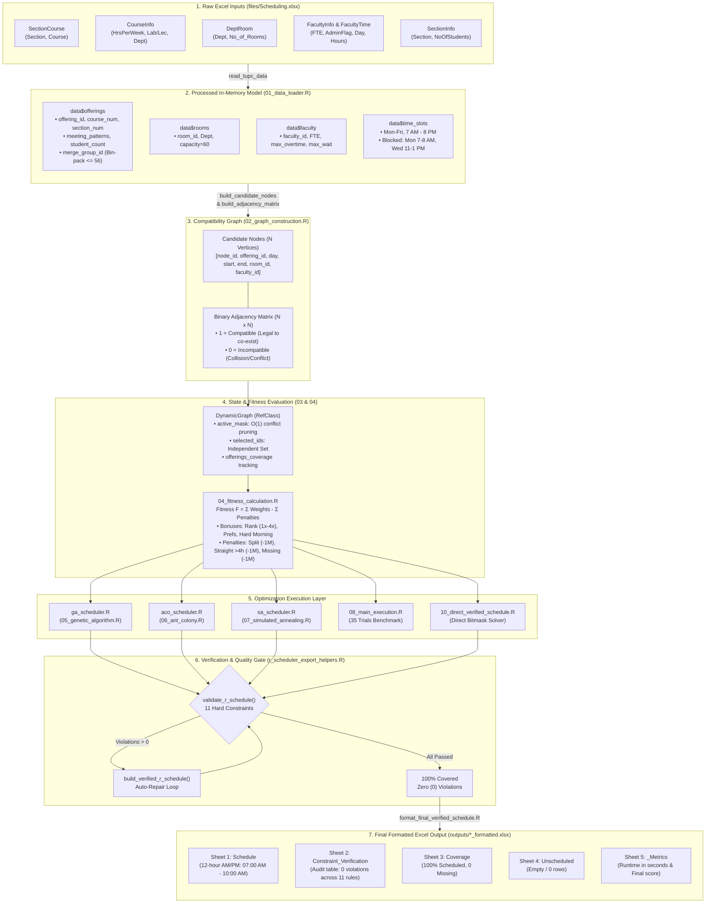

# TUPC Scheduling System — Data Diagram & Flow Sketch

---

## 1. End-to-End Data Pipeline Sketch (ASCII)

```text
========================================================================================================================
                                             DATA FLOW & TRANSFORMATION SKETCH
========================================================================================================================

 [ 1. RAW EXCEL INPUTS ]
   files/Scheduling.xlsx
   ├── SectionCourse  : (Section, Course)
   ├── CourseInfo     : (Course, HrsPerWeek, Lab.1_Lec.2, Dept, Difficulty)
   ├── DeptRoom       : (Dept, No_of_Rooms)
   ├── FacultyInfo    : (Faculty, FTE, w/admin(0)_or_none(1), eligibility)
   ├── FacultyCourse  : (Faculty, Course)
   ├── FacultyTime    : (Faculty, Day, Time_from, Time_to)
   ├── FacultySection : (Faculty, Section)
   └── SectionInfo    : (Section, NoOfStudents)
            │
            │  01_data_loader.R (Parsing, Rule Computation & Greedy Bin-Packing)
            ▼
 [ 2. IN-MEMORY SANITIZED DATA (data$*) ]
   ├── data$courses   : [Course, course_code, total_units, is_lab, is_hard, room_type_required]
   ├── data$faculty   : [faculty_id, FTE, category (0/1/2), max_workload, max_overtime, max_waiting_hours]
   ├── data$rooms     : [room_id, room_name, Dept, capacity=60, room_type]
   ├── data$sections  : [section_id, student_count]
   ├── data$time_slots: [time_slot_id, day (Mon-Fri), hour_start (7-19), hour_end (8-20)]
   ├── data$blocked   : [time_slot_ids for Mon 7-8 AM, Wed 11-1 PM]
   └── data$offerings : [offering_id, course_num, section_num, faculty_id, student_count,
                         meeting_patterns, merge_group_id (classes <= 56 merged)]
            │
            │  02_graph_construction.R (Meeting Pattern Expansion & Collision Matrix)
            ▼
 [ 3. COMPATIBILITY GRAPH MODEL ]
   ┌────────────────────────────────────────────────────────────────────────────────────────┐
   │ NODES DATAFRAME (N Candidate Vertices)                                                 │
   │ [ node_id | offering_id | unit_key | day | hour_start | hour_end | room_id | faculty_id ]│
   └──────────────────────────────────────────┬─────────────────────────────────────────────┘
                                              │
                                              ▼
   ┌────────────────────────────────────────────────────────────────────────────────────────┐
   │ ADJACENCY MATRIX (N x N Binary Matrix)                                                 │
   │              Node 1    Node 2    Node 3  ...  Node N                                    │
   │      Node 1 [   0         1         0           1   ]   1 = Compatible (No Clash)      │
   │      Node 2 [   1         0         1           0   ]   0 = Conflict (Incompatible:    │
   │      Node 3 [   0         1         0           0   ]       Room, Prof, Section, Split)│
   │      Node N [   1         0         0           0   ]                                  │
   └──────────────────────────────────────────┬─────────────────────────────────────────────┘
                                              │
                                              │  03_dynamic_node_selection.R & 04_fitness_calculation.R
                                              ▼
 [ 4. DYNAMIC STATE & EVALUATION ]
   ┌────────────────────────────────────────────────────────────────────────────────────────┐
   │ DynamicGraph STATE                                                                     │
   │ • active_mask       : [TRUE, FALSE, TRUE, ...] -> O(1) deactivates conflicts           │
   │ • selected_ids      : [node_id_A, node_id_B, ...] -> current independent set           │
   │ • offerings_coverage: [Offering 1: 2/2, Offering 2: 1/1, ...]                          │
   │                                                                                        │
   │ FITNESS FUNCTION                                                                       │
   │ • Score F = Σ (Base W + Rank Bonus + Pref Bonus) - Σ (Hard Penalties: -1M each)        │
   └──────────────────────────────────────────┬─────────────────────────────────────────────┘
                                              │
                                              │  05_GA / 06_ACO / 07_SA Solvers
                                              ▼
 [ 5. OPTIMIZATION RUNNERS ]
   ├── ga_scheduler.R  ──► 05_genetic_algorithm.R   : Chromosome Permutation -> DynamicGraph
   ├── aco_scheduler.R ──► 06_ant_colony.R          : Pheromone τ & Heuristic η -> Ant Tours
   ├── sa_scheduler.R  ──► 07_simulated_annealing.R : Swap/Insert/Remove/Relocate Moves
   └── 08_main_exec.R  ──► 35 Trials Comparison     : ANOVA, Kruskal-Wallis, ggplot2
            │
            │  r_scheduler_export_helpers.R (Independent 11-Constraint Quality Gate)
            ▼
 [ 6. VERIFICATION QUALITY GATE ]
   ├── Rule 1: 100% Coverage (No missing/duplicate classes)      ──► Violations: 0
   ├── Rule 2: Cut-off time <= 8:00 PM                           ──► Violations: 0
   ├── Rule 3: Department-room compatibility                     ──► Violations: 0
   ├── Rule 4: Room capacity >= student enrollment               ──► Violations: 0
   ├── Rule 5: Room overlap                                      ──► Violations: 0
   ├── Rule 6: Faculty overlap                                   ──► Violations: 0
   ├── Rule 7: Section overlap                                   ──► Violations: 0
   ├── Rule 8: Faculty lunch break (10 AM - 1 PM)                ──► Violations: 0
   ├── Rule 9: Section lunch break (10 AM - 1 PM)                ──► Violations: 0
   ├── Rule 10: Max straight hours <= 4h                         ──► Violations: 0
   └── Rule 11: Faculty availability & workload limits           ──► Violations: 0
            │
            │  format_final_verified_schedule.R & writexl
            ▼
 [ 7. PRODUCTION EXCEL WORKBOOK ]
   outputs/*_schedule_formatted.xlsx
   ├── Tab 1: [Schedule]              (day, time_formatted "07:00 AM - 10:00 AM", course, sec, room, fac)
   ├── Tab 2: [Constraint_Verification] (Audited breakdown showing 0 violations across all 11 rules)
   ├── Tab 3: [Coverage]              (offering_id, required_meetings, scheduled_meetings, missing=0)
   ├── Tab 4: [Unscheduled]           (0 rows / completely empty)
   └── Tab 5: [<ALGO>_Metrics]        (computation_time_seconds, final_fitness_score)
========================================================================================================================
```

---

## 2. Visual Data Flowchart (Mermaid)



---

## 3. Data Transformation Schema Matrix

| Stage | Input Data | Transformation Code | Produced Data Structure | Key Fields / Schema |
|---|---|---|---|---|
| **1. Ingestion** | `files/Scheduling.xlsx` (8 sheets) | `01_data_loader.R` (`read_tupc_data`) | `data` (Named List of Tibbles) | `offerings`, `rooms`, `faculty`, `sections`, `time_slots`, `blocked_slots` |
| **2. Class Merging** | Multiple offerings with same Course, Faculty, Dept | `01_data_loader.R` (Greedy Bin Packing) | `data$offerings$merge_group_id` | Combined student count $\le 56$; identical room & time slot |
| **3. Graph Discretization** | `data$offerings`, `rooms`, `time_slots` | `02_graph_construction.R` (`build_candidate_nodes`) | `nodes` ($N$ rows dataframe) | `node_id`, `offering_id`, `day`, `hour_start`, `hour_end`, `room_id`, `faculty_id`, `unit_key` |
| **4. Compatibility Matrix** | Pairwise check between all $N$ nodes | `02_graph_construction.R` (`build_adjacency_matrix`) | `adjacency` ($N \times N$ Matrix) | `1` = Compatible (legal pair); `0` = Incompatible (collision) |
| **5. State Tracking** | `nodes` + `adjacency` | `03_dynamic_node_selection.R` (`DynamicGraph`) | Reference Class instance | `active_mask` (logical vector), `selected_ids` (integer vector), `offerings_coverage` |
| **6. Scoring** | `selected_nodes_df` | `04_fitness_calculation.R` (`calculate_fitness`) | List: `F`, `sum_vertex_weights`, `schedule_penalty`, `coverage_penalty` | Fitness $F = \sum \text{Weights} - \sum \text{Penalties}$ |
| **7. Optimization** | Graph + Fitness | `ga_scheduler.R` / `aco_scheduler.R` / `sa_scheduler.R` | Raw solved schedule | `result$schedule`, `result$fitness`, `result$time_sec` |
| **8. Audit Gate** | Raw schedule + `data` | `r_scheduler_export_helpers.R` (`validate_r_schedule`) | `verification` dataframe | Checklist of 11 hard rules (must be all 0 violations) |
| **9. Post-Formatting** | 24-hr integer hours (7 to 20) | `format_final_verified_schedule.R` | Final Excel Workbook | `time_formatted` (`"07:00 AM - 10:00 AM"`), day-sorted rows |

---

## 4. Visual Sketch ng Graph State & Dynamic Pruning

Kapag pinili ang isang candidate node (halimbawa, Node #1):

```text
    Initial Candidate Pool: [ Node 1, Node 2, Node 3, Node 4, Node 5, ... Node N ]
    active_mask:            [  TRUE,   TRUE,   TRUE,   TRUE,   TRUE,  ...  TRUE  ]

    --- PUMILI NG NODE #1 (e.g., Math101, Sec A, Room 101, Mon 08:00 - 10:00, Prof Cruz) ---
    
    Adjacency Vector para sa Node #1:
    adjacency[1, ] = [ 0,  1,  0,  1,  0, ... ]
                       │   │   │   │   │
                       │   │   │   │   └── Node 5: Nagko-conflict (same Room 101 at Mon 08:00) ──► DEACTIVATE
                       │   │   │   └────── Node 4: Compatible (Ibang araw/kwarto/prof)          ──► KEEP ACTIVE
                       │   │   └────────── Node 3: Nagko-conflict (same Prof Cruz at Mon 08:00) ──► DEACTIVATE
                       │   └────────────── Node 2: Compatible (Ibang klase)                     ──► KEEP ACTIVE
                       └────────────────── Node 1: Napili na (hindi na puwedeng piliin ulit)   ──► DEACTIVATE

    Updated active_mask pagkatapos ng O(1) Vectorized Pruning:
    active_mask: [ FALSE, TRUE, FALSE, TRUE, FALSE, ... ]
    
    Resulta: Awtomatikong naiwasan ang lahat ng room, professor, at section conflicts!
```
