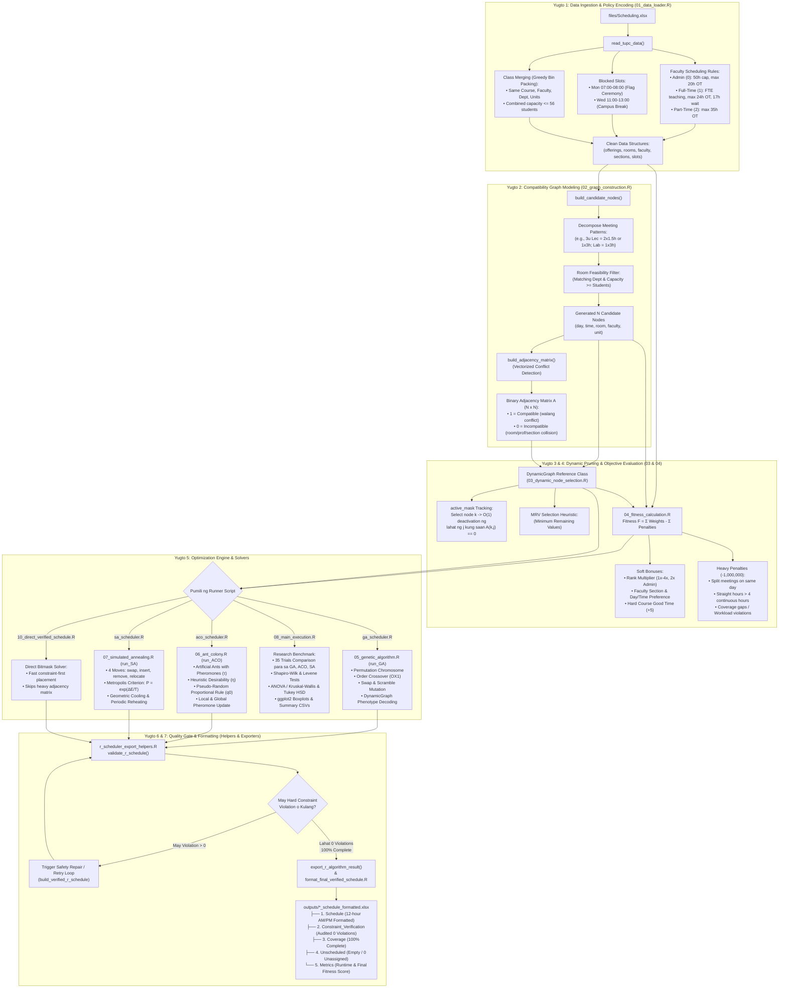
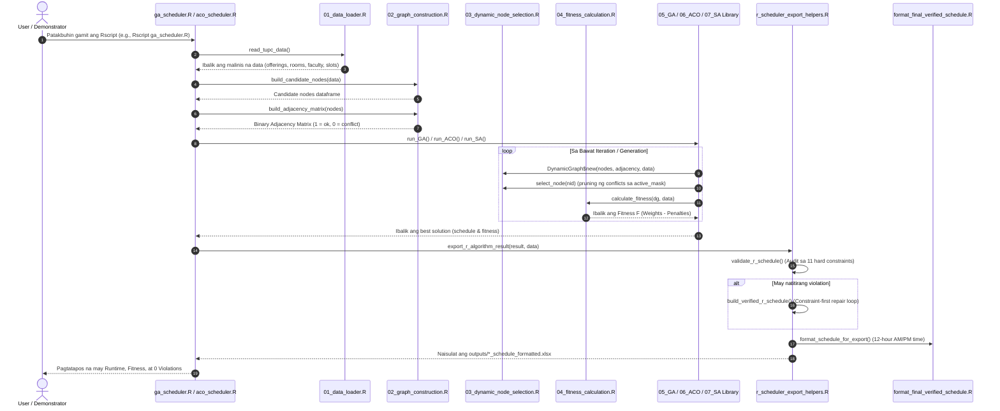

# TUPC Automated Class Scheduling System — Process Flow Sketch

Dokumentong naglalaman ng komprehensibong **Process Flow Sketches**, diagram, at sunod-sunod na mekanismo ng buong scheduling pipeline mula sa input data hanggang sa pinal na verified Excel schedule.

---

## 1. High-Level Process Flow Diagram (Mermaid)



---

## 2. ASCII Schematic Sketch ng System Process Flow

```text
=================================================================================================================
                                TUPC AUTOMATED CLASS SCHEDULING SYSTEM
                                       END-TO-END PROCESS SKETCH
=================================================================================================================

  [ STEP 1: INPUT DATA ]
          │
          ├── files/Scheduling.xlsx (SectionCourse, SectionInfo, CourseInfo, DeptRoom, FacultyInfo, Time)
          ▼
  ┌─────────────────────────────────┐
  │ 01_data_loader.R                │
  │ • Parse institutional rules     ├─► Exclude Blocked Slots (Mon 7-8 AM, Wed 11-1 PM)
  │ • Apply faculty limits          ├─► Admin (50h cap, 20h OT), FT (FTE, 24h OT, 17h wait), PT (35h OT)
  │ • Greedy Class Merging          └─► Bin-pack same course/prof/dept up to 56 students per merged room
  └─────────────────┬───────────────┘
                    │ sanitized data (offerings, rooms, faculty, sections, slots)
                    ▼
  ┌─────────────────────────────────┐
  │ 02_graph_construction.R         │
  │ • build_candidate_nodes()       ├─► Generates candidate nodes (day, hour, room, faculty, unit)
  │ • Room compatibility check      ├─► Ensures matching Dept & room capacity >= student count
  │ • build_adjacency_matrix()      └─► Computes N x N Compatibility Matrix:
  │                                     [ 1 = Compatible (Legal Pair) | 0 = Incompatible (Conflict) ]
  └─────────────────┬───────────────┘
                    │ graph vertices & adjacency matrix
                    ▼
  ┌─────────────────────────────────┐
  │ 03_dynamic_node_selection.R     │
  │ • DynamicGraph (RefClass)       ├─► active_mask: O(1) vectorized deactivation ng conflicts
  │ • schedule_greedy_construct()   └─► Minimum Remaining Values (MRV) heuristic: prioritize tightest nodes
  └─────────────────┬───────────────┘
                    │ dynamic graph state
                    ▼
  ┌─────────────────────────────────┐
  │ 04_fitness_calculation.R        │
  │ • Objective Function            ├─► Fitness F = Σ Adjusted Weights - Σ Penalties
  │ • Bonuses                       ├─► Faculty Rank (1x-4x, 2x Admin), Preferences, Hard Course 8AM-4PM (+5)
  │ • Penalties                     └─► Soft (-1 to -10), Catastrophic Hard Penalties (-1,000,000 bawat violation)
  └─────────────────┬───────────────┘
                    │
                    ▼
┌───────────────────────────────────────────────────────────────────────────────────────────────────────────────┐
│ STEP 5: OPTIMIZATION EXECUTION LAYER                                                                          │
│ (Pumili ng partikular na scheduler depende sa layunin ng pagpapatakbo)                                        │
│                                                                                                               │
│ [ A. Genetic Algorithm ]        [ B. Ant Colony Opt. ]       [ C. Simulated Annealing ]   [ D. Research Bench ]│
│         │                                 │                            │                          │           │
│         ▼                                 ▼                            ▼                          ▼           │
│   ga_scheduler.R                   aco_scheduler.R               sa_scheduler.R           08_main_execution.R │
│         │                                 │                            │                          │           │
│         ▼                                 ▼                            ▼                          ▼           │
│ 05_genetic_algorithm.R            06_ant_colony.R              07_simulated_annealing.R   35 Multi-trials     │
│ • Permutation chromosome          • Artificial ants            • 4 Neighborhood moves:    • GA vs ACO vs SA   │
│ • Order Crossover (OX1)           • Pheromone trails (τ)         swap, insert, remove,    • ANOVA / Kruskal   │
│ • Swap / Scramble Mutation        • Heuristic info (η)           relocate moves           • Tukey HSD tests   │
│ • Tournament selection            • Pseudo-random rule (q0)    • Metropolis Criterion     • ggplot2 plots     │
│ • Phenotype graph decoding        • Local & global updates     • Geometric cooling + reheat                   │
└───────────────────────────────────────────┬───────────────────────────────────────────────────────────────────┘
                                            │ candidate solution
                                            ▼
  ┌─────────────────────────────────┐
  │ 06. QUALITY GATE & AUDIT        │
  │ r_scheduler_export_helpers.R    │
  │ • validate_r_schedule()         ├─► Independent 11-Rule Hard Constraint Audit
  │                                 │   [ Coverage, Cut-off 8 PM, Capacity, Dept Match, Room Overlap,
  │                                 │     Faculty Overlap, Section Overlap, Faculty Lunch, Section Lunch,
  │                                 │     Max 4 Straight Hours, Faculty Workload & Waiting Times ]
  │                                 │
  │ • Validation Check              ├──► May Violation > 0? ──► [ Automatic Repair / Retry Loop ]
  │                                 │                                          │
  │                                 └──► Zero Violations (0) ◄─────────────────┘
  └─────────────────┬───────────────┘
                    │ verified 100% compliant schedule
                    ▼
  ┌─────────────────────────────────┐
  │ 07. EXPORT & BEAUTIFICATION     │
  │ format_final_verified_schedule.R│
  │ • writexl multi-sheet workbook  ├─► outputs/*_schedule_formatted.xlsx
  │ • 12-hour AM/PM formatting      │   ├── Sheet 1: Schedule (12-hour AM/PM display, sorted by day/time)
  │                                 │   ├── Sheet 2: Constraint_Verification (Audited 0 Violations)
  │                                 │   ├── Sheet 3: Coverage (100% Scheduled, 0 Missing)
  │                                 │   ├── Sheet 4: Unscheduled (0 Unassigned Classes)
  │                                 │   └── Sheet 5: <ALGO>_Metrics (Exact Runtime & Fitness Score)
  └─────────────────────────────────┘
=================================================================================================================
```

---

## 3. Sequence Diagram ng Interaksyon ng mga File (Mermaid)

Ipinapakita ng sequence diagram sa ibaba ang pagkakasunod-sunod ng function calls kapag pinatakbo ang isa sa mga standalone schedulers (halimbawa, `ga_scheduler.R` o `aco_scheduler.R`):



---

## 4. Pitong (7) Yugto ng Proseso (Detailed Step-by-Step Breakdown)

### Yugto 1: Paghahanda ng Datos at Administrative Rules ([01_data_loader.R](file:///D:/DEVELOPMENT/Scheduling-System-R/01_data_loader.R))
1. Binabasa ang institutional data mula sa `files/Scheduling.xlsx`.
2. Ipinapatupad ang faculty workload rules ayon sa kategorya:
   - **With Admin Duties (Category 0):** Maximum 50 kabuuang oras, teaching FTE katumbas ng FTE, at maximum 20 oras ng overtime.
   - **Full-Time (Category 1):** Teaching FTE katumbas ng FTE, maximum 24 oras ng overtime, at maximum 17 oras ng waiting time.
   - **Part-Time (Category 2):** Maximum 35 oras ng overtime.
3. Ibinubukod ang institutional blocked time slots (Lunes 7:00–8:00 AM Flag Ceremony, Miyerkules 11:00 AM–1:00 PM Campus Break).
4. **Greedy Class Merging:** Pinagsasama ang magkaparehong kurso at propesor hanggang sa 56 estudyante gamit ang Largest-Section-First bin packing upang maiwasan ang dobleng pagtuturo sa magkahiwalay na kwarto.

---

### Yugto 2: Discretization at Graph Modeling ([02_graph_construction.R](file:///D:/DEVELOPMENT/Scheduling-System-R/02_graph_construction.R))
1. Bawat klase ay hinahati ayon sa meeting pattern (e.g., 3-unit lecture = dalawang 1.5h meetings o isang 3h meeting).
2. Nagsasala lamang ng kwarto na angkop sa Department at may sapat na kapasidad para sa bilang ng estudyante.
3. Bumubuo ng $N$ candidate nodes na naglalaman ng `(offering_id, meeting_idx, day, start, end, room, faculty)`.
4. Binu-buo ang $N \times N$ **Adjacency Matrix** kung saan ang `1` ay compatible at ang `0` ay conflict (room overlap, faculty overlap, section overlap, o split meeting sa parehong araw).

---

### Yugto 3: Dynamic State Tracking at Conflict Elimination ([03_dynamic_node_selection.R](file:///D:/DEVELOPMENT/Scheduling-System-R/03_dynamic_node_selection.R))
1. Ang `DynamicGraph` (Reference Class) ay nagpapanatili ng `active_mask` para sa mga legal pang nodes.
2. Sa pagpili ng isang node, agad na binabago patungong `FALSE` sa `active_mask` ang lahat ng nodes na nagdudulot ng conflict sa pamamagitan ng vectorized matrix slicing sa $O(1)$ bilis.
3. Ang `schedule_greedy_construct()` ay gumagamit ng **Minimum Remaining Values (MRV)** heuristic — inuuna nitong i-schedule ang mga klaseng may pinakakaunting natitirang active candidate nodes upang maiwasan ang maagang pagkakaipit (dead-end).

---

### Yugto 4: Multi-Objective Fitness Evaluation ([04_fitness_calculation.R](file:///D:/DEVELOPMENT/Scheduling-System-R/04_fitness_calculation.R))
1. Kinakalkula ang objective function:
   $$\text{Fitness } F = \sum (\text{Adjusted Node Weights}) - \sum (\text{Penalties})$$
2. **Bonuses:** Base weight (100) + Academic rank multipliers (1x–4x, 2x kung may Admin) + Faculty preferred sections + Faculty preferred day/time + Hard course morning slot (+5).
3. **Heavy Hard Penalties (-1,000,000 bawat paglabag):**
   - Split meetings ng parehong klase sa iisang araw.
   - Straight hours excess ($> 4$ continuous hours nang walang pahinga para sa estudyante o propesor).
   - Missing meeting coverage (-1,000,000 bawat kulang na klase).
   - Faculty workload violations (underload, sobrang overtime, o labis na waiting time).

---

### Yugto 5: Pagpapatakbo ng Optimization Solver
Pumipili ang user o script kung aling solver ang patatakbuhin:
* **Option A: Genetic Algorithm ([ga_scheduler.R](file:///D:/DEVELOPMENT/Scheduling-System-R/ga_scheduler.R) $\rightarrow$ [05_genetic_algorithm.R](file:///D:/DEVELOPMENT/Scheduling-System-R/05_genetic_algorithm.R))**
  - Permutation chromosomes na sumasailalim sa Tournament Selection, Order Crossover (OX1), Swap/Scramble Mutation, at Elitism.
* **Option B: Ant Colony Optimization ([aco_scheduler.R](file:///D:/DEVELOPMENT/Scheduling-System-R/aco_scheduler.R) $\rightarrow$ [06_ant_colony.R](file:///D:/DEVELOPMENT/Scheduling-System-R/06_ant_colony.R))**
  - Artificial ants na naglalakbay gamit ang pheromones ($\tau$), heuristic desirability ($\eta$), ACS pseudo-random rule ($q_0$), at local/global evaporation at deposit.
* **Option C: Simulated Annealing ([sa_scheduler.R](file:///D:/DEVELOPMENT/Scheduling-System-R/sa_scheduler.R) $\rightarrow$ [07_simulated_annealing.R](file:///D:/DEVELOPMENT/Scheduling-System-R/07_simulated_annealing.R))**
  - Local trajectory search gamit ang 4 moves (`swap`, `insert`, `remove`, `relocate`), Metropolis probability ($P = \exp(\Delta E / T)$), geometric cooling, at periodic reheating.
* **Option D: Research Benchmark ([08_main_execution.R](file:///D:/DEVELOPMENT/Scheduling-System-R/08_main_execution.R))**
  - 35 trials bawat algorithm, hypothesis testing (ANOVA / Kruskal-Wallis), at visualization plots.
* **Option E: Direct Constraint Solver ([10_direct_verified_schedule.R](file:///D:/DEVELOPMENT/Scheduling-System-R/10_direct_verified_schedule.R))**
  - Mabilis na constructive bitmask placement nang hindi gumagawa ng mabigat na adjacency matrix.

---

### Yugto 6: Quality Gate at Independent Constraint Audit ([r_scheduler_export_helpers.R](file:///D:/DEVELOPMENT/Scheduling-System-R/r_scheduler_export_helpers.R))
1. Bago i-save ang anumang schedule, sinusuri ito ng `validate_r_schedule()` laban sa **11 hard constraints**:
   - 100% Meeting Coverage
   - Cut-off time $\le$ 8:00 PM
   - Sapat na room capacity
   - Department-room compatibility
   - Zero room overlap
   - Zero faculty overlap
   - Zero section/student overlap
   - May 1-hour Faculty lunch break (10:00 AM–1:00 PM)
   - May 1-hour Section lunch break (10:00 AM–1:00 PM)
   - Straight hours $\le 4$ continuous hours
   - Sinusunod ang Faculty availability at workload limits
2. **Auto-Repair / Retry Loop:** Kung may anumang violation na higit sa 0 o may kulang na klase, awtomatikong magti-trigger ang constraint-first repair (`build_verified_r_schedule()`) upang tiyaking 100% legal ang output bago i-save.

---

### Yugto 7: Pinal na Pag-export at Pag-format ([format_final_verified_schedule.R](file:///D:/DEVELOPMENT/Scheduling-System-R/format_final_verified_schedule.R))
1. Ang pinal na resulta ay isinusulat bilang five-sheet Excel workbook (`outputs/*_schedule_formatted.xlsx`):
   - **`Schedule`:** Na-format na talaan ng klase na may 12-hour AM/PM display (e.g., `07:00 AM - 10:00 AM`), nakaayos ayon sa araw (Lunes–Biyernes) at oras.
   - **`Constraint_Verification`:** Audit checklist kung saan ang lahat ng 11 rules ay may markang **0 violations**.
   - **`Coverage`:** Detalyadong talaan ng bawat kurso at seksyon (Scheduled vs Required meetings).
   - **`Unscheduled`:** Talaan ng anumang naiwang klase (dapat walang laman / 0 unassigned).
   - **`<ALGO>_Metrics`:** Naglalaman ng aktuwal na computation time sa segundo at pinal na fitness score.
